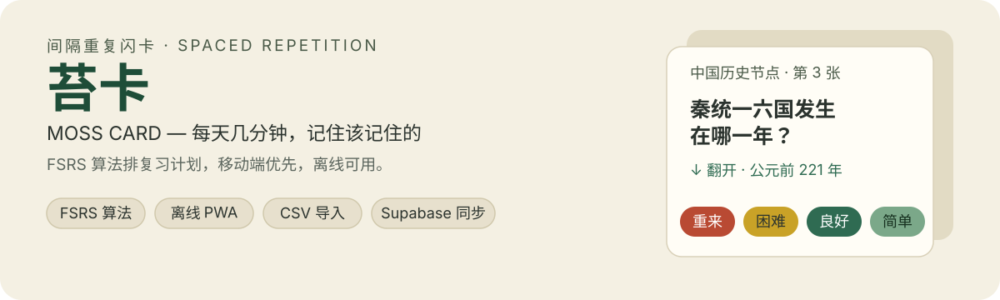
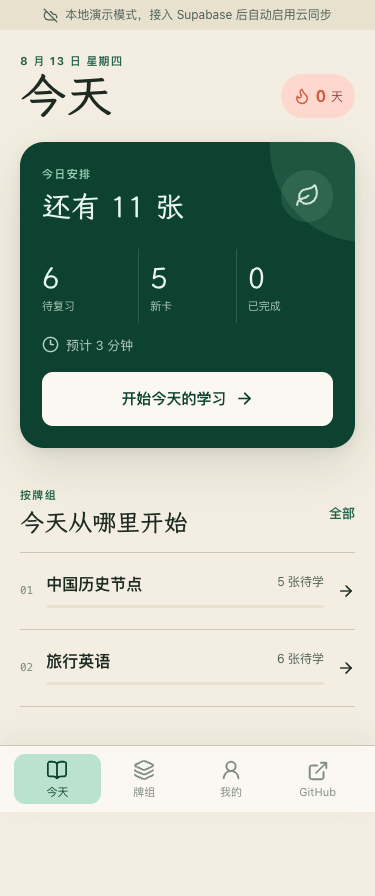

<p align="right"><a href="README.md">中文</a></p>

<p align="center">
  
</p>

<p align="center">
  <a href="https://xiaosang.cc/flash-card/">▶ Try Online</a>
  ·
  <a href="https://github.com/holynova/flash-card">GitHub Repository</a>
</p>

Moss Card is a mobile-first spaced-repetition flashcard PWA powered by the FSRS algorithm: open it and today's queue — reviews due and new cards — is right there. Local-first and offline-capable; connect Supabase to enable cloud sync. No points, no trophies, just a study book you open every day.

## Screenshot

<p align="center">
  
</p>

## Features

- **FSRS scheduling**: after each review you grade yourself on four levels — 「重来」 Again / 「困难」 Hard / 「良好」 Good / 「简单」 Easy — and the algorithm computes the next review date. Defaults: 10 new cards per day, 90% desired retention.
- **Today page**: reviews due, new cards, and completed count at a glance; one tap starts the session.
- **Decks**: create decks and cards, with per-deck daily new-card limits and retention targets.
- **Bulk import**: CSV/TSV files (UTF-8, up to 5 MB, max 5,000 cards per import), with a preview step and one-click revert of the whole import.
- **Local-first**: data lives in IndexedDB and works offline; without Supabase it runs in local demo mode, and sync status is always visible.
- **Cloud sync (optional)**: connect Supabase to sync decks and review history across devices; includes an account-deletion Edge Function.
- **PWA**: installable, works offline; privacy policy and terms pages included.

Two built-in demo decks (10 cards total) — 「旅行英语」 ("Travel English", 5) and 「中国历史节点」 ("Chinese History Milestones", 5) — so you can start studying right away.

## Run Locally

```bash
pnpm install
pnpm dev        # dev server
pnpm build      # type check + build
pnpm test       # Vitest unit tests
pnpm e2e        # Playwright end-to-end tests
```

Local demo mode needs no configuration at all; to enable cloud sync, copy `.env.example` and fill in the Supabase URL and anon key.

## Tech

- React 19 + TypeScript + Vite, React Router 7, mobile-first (from 375px up; narrow left nav on desktop).
- Spaced repetition: `ts-fsrs` (FSRS algorithm); local storage: Dexie (IndexedDB); cloud sync: Supabase (with Auth and Edge Functions).
- PWA: vite-plugin-pwa + Workbox, works offline; CSV parsing: PapaParse; form validation: Zod.
- Design baseline in `DESIGN.md`: morning light on paper — warm ivory background, moss-green primary, Kai-style headings; touch targets at least 44px.

```
src/App.tsx            Routes: Today / Decks / Study / Import / Me / Login
src/pages/             Pages: TodayPage, StudyPage, DeckDetailPage, ImportPage, etc.
src/lib/scheduler.ts   FSRS scheduling: four grades → next review date
src/data/              Local store (Dexie) and Supabase store + seed data
supabase/functions/    Edge Functions: submit-review, delete-account
public/                PWA manifest, icons, sample screenshots
docs/                  Build output
```
